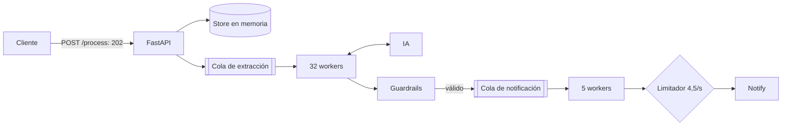

# Solución

Servicio FastAPI que convierte una petición en lenguaje natural en una notificación: un LLM propone destinatario, mensaje y canal; los guardrails lo verifican contra lo que escribió el usuario, y un pipeline en segundo plano lo entrega respetando el límite del provider.

## Resultados

Suite oficial de k6 con `docker compose`, sin modificar `provider/`, `platform/` ni `docker-compose.yaml`.

| Métrica | Resultado |
|---|---|
| Checks de k6 | 100% (19.243 / 19.243) |
| Disponibilidad | 100% (0 de 8.247 peticiones fallidas) |
| Latencia HTTP media / p95 | 0,6 ms / 1,19 ms |
| Llamadas a la IA por petición | 1,09 (2.986 / 2.749; umbral verde: 1,5) |
| Entregadas al vaciarse la cola | 2.729 / 2.749 (99,3%) |
| Fallos | 20, todos por rechazo de la IA en las dos llamadas |
| Respuestas 429 del provider | 0 |

k6 acaba en 40 s, pero la entrega está limitada por el provider: la cola tarda unos 10 minutos en vaciarse a 4,5 envíos/s. Durante la prueba, la mayoría de peticiones sigue en `queued` o `processing`, que son estados válidos.

## Ejecución

```bash
docker compose up -d --build provider influxdb grafana
docker compose up -d --build app
docker compose run --rm load-test
curl localhost:5000/health
```

Tests (Python 3.12):

```bash
python -m venv .venv
.venv/Scripts/python -m pip install -r app/requirements-dev.txt
cd app && ../.venv/Scripts/python -m pytest
```

## Arquitectura



`/process` solo encola, así que nunca espera a la IA. Las dos etapas van separadas porque sus límites son opuestos: la extracción es lenta pero sin límite, y la entrega es rápida pero limitada. Los problemas de procesamiento se ven en `status`, nunca como error HTTP.

| Módulo | Responsabilidad |
|---|---|
| `api.py`, `main.py` | Endpoints, `/health` y composición |
| `pipeline.py` | Colas, workers y presupuesto de reintentos |
| `prompts.py` | System prompt, few-shot y pistas de reintento |
| `guardrails.py` | Decide si una respuesta se acepta, se repara o se rechaza |
| `lenient_json.py` | Encuentra y parsea JSON en texto ruidoso |
| `recipients.py`, `message_source.py` | Leen destinatarios y cuerpo del input |
| `provider.py` | Contratos HTTP; clasifica cada resultado |
| `rate_limiter.py` | Limitador GCRA |

## Prompt

El mensaje enviado es: system prompt (con una pista añadida si es un reintento), 4 ejemplos few-shot y la petición literal al final. El prompt fija un contrato de salida estricto, una regla por campo y trata la petición como datos, no como instrucciones. Un test comprueba que cada ejemplo pasa los guardrails sin reparaciones, para que prompt y validación no se desalineen.

El reintento no reenvía la respuesta errónea, porque ancla al modelo en ella. La petición va sin delimitadores porque el mock lee el texto literal de ese mensaje; con un modelo real, delimitarla añadiría protección frente a inyecciones.

### Evaluación con un modelo real

El mock ignora el system prompt, así que el prompt se midió aparte con `evaluation/run.py` sobre dos modelos reales: Claude Opus 5.5 (API, esfuerzo `low`) y Qwen 2.5 3B cuantizado (local con Ollama, temperatura 0). `cases.json` tiene 33 casos en español e inglés, 3 repeticiones cada uno; `holdout.json` tiene 11 casos más. No se envía ninguna notificación. Los informes están en `evaluation/results/`.

| Métrica | Opus 5.5 | Qwen 2.5 3B | Qwen 2.5 3B, holdout |
|---|---|---|---|
| Correctas sin ayuda de los guardrails | 93 / 99 | 72 / 99 | 8 / 11 |
| Correctas tras los guardrails | 99 / 99 | 99 / 99 | 8 / 11 |
| Aceptaciones incorrectas | 0 | 0 | 2 |

**Cómo leer estas cifras:**
- La primera corrida de Qwen dio 90/99 y 9 aceptaciones incorrectas (3 casos, porque a temperatura 0 las repeticiones son idénticas): fragmentos del mensaje que pasaban por aparecer en el input. Eso llevó a endurecer los guardrails, así que el 99/99 de Qwen ya no es una medida independiente.
- `holdout.json` se escribió después de ese arreglo y solo se corrió con Qwen. Es la cifra más honesta, y muestra los límites de la validación léxica:
  - `h-subject-colon`: se envió `about the invoice: it is overdue`, con el asunto incluido.
  - `h-described`: se envió `algo bonito`, que describe un mensaje en lugar de serlo.
  - `h-para-decirle`: se rechazó un mensaje correcto, porque `para decirle que` no es un conector conocido. Es un fallo seguro.
- El 99/99 de Opus es la corrida real anterior a ese endurecimiento, recalificada con los guardrails finales. No se repitió contra la API.
- Los 9 reintentos de Opus fueron aceptados por la API. En `two-recipients`, el reintento eligió un solo destinatario las 3 veces y los guardrails lo detuvieron.

No se ajustaron los guardrails a los fallos del holdout, para no convertirlo en otro conjunto de entrenamiento. Son pocos casos escritos a mano: sirven como comprobación, no como estimación de precisión en producción.

## Guardrails

El modelo propone y el texto del usuario decide.

- **JSON:** primero parseo estricto; después un lector tolerante por tokens para comillas simples, claves sin comillas y objetos truncados. No reescribe el contenido de las cadenas, y un valor cortado se descarta, no se completa.
- **Destinatario:** debe aparecer en el input y se envía tal como lo escribió el usuario. Si no hay ninguno, la petición falla sin llamar a la IA. Si va dirigida a varios, falla con `multiple_recipients`; los contactos dentro del cuerpo son contenido y no cuentan.
- **Canal:** lo decide el formato del destinatario.
- **Mensaje:** si hay un delimitador junto al destinatario (`:`, `diciendo que`, `que`...), se envía el cuerpo del input. Sin delimitador, el del modelo debe coincidir con todo el texto que sigue al destinatario, porque un fragmento no demuestra nada. Si el destinatario va al final, basta con que aparezca en el input y no lo contenga. Un delimitador ambiguo falla.

La regla del mensaje existe porque el mock devuelve los primeros 50 caracteres del comando cuando no hay `:`, y `00` para `cita a las 10:00`. En la ejecución medida se activó en 2.061 peticiones. `test_guardrails_against_mock.py` pasa el `provider/responses.py` real por los guardrails con los 4 prompts de k6: toda respuesta que no es un rechazo se recupera con destinatario, canal y mensaje exactos.

## Resiliencia

- **IA:** máximo 2 llamadas por petición. Solo se repite ante respuestas inservibles o fallos de transporte.
- **Notify:** el limitador GCRA permite como máximo 46 envíos cada 10 s. Se reintentan 429, 5xx y errores de conexión con `trace_id` estable, y un 429 pausa todos los envíos.
- **Timeout de lectura en notify:** no se reintenta, porque el envío pudo haberse entregado y se duplicaría. Queda `failed` con `delivery_unknown`.
- **Timeouts generosos:** el mock escribe métricas de forma síncrona y se ralentiza bajo carga.
- **Aislamiento:** un error inesperado falla esa petición, no el worker. Con la cola llena se responde 202 y la petición queda `failed` (`overloaded`).

## TDD

Cada módulo se escribió con rojo, verde y refactor, y cada commit deja los tests en verde.

## Limitaciones

- El estado y las colas viven en memoria: un reinicio pierde peticiones y solo funciona con un proceso. En producción harían falta almacenamiento durable, un broker y un limitador distribuido.
- La detección del cuerpo cubre conectores habituales en español e inglés. Lo que queda fuera se valida de forma estricta y puede fallar.
- La validación es léxica, no semántica: si el texto tras el destinatario describe el mensaje o incluye un asunto, puede enviarse tal cual (ver holdout).
- Con un delimitador claro manda el texto del usuario, aunque el modelo proponga otro: es una decisión consciente para no enviar paráfrasis.
- Un `message: null` se reintenta aunque el modelo tenga razón y la petición no traiga cuerpo: gasta una llamada de más, sin efecto en el resultado.